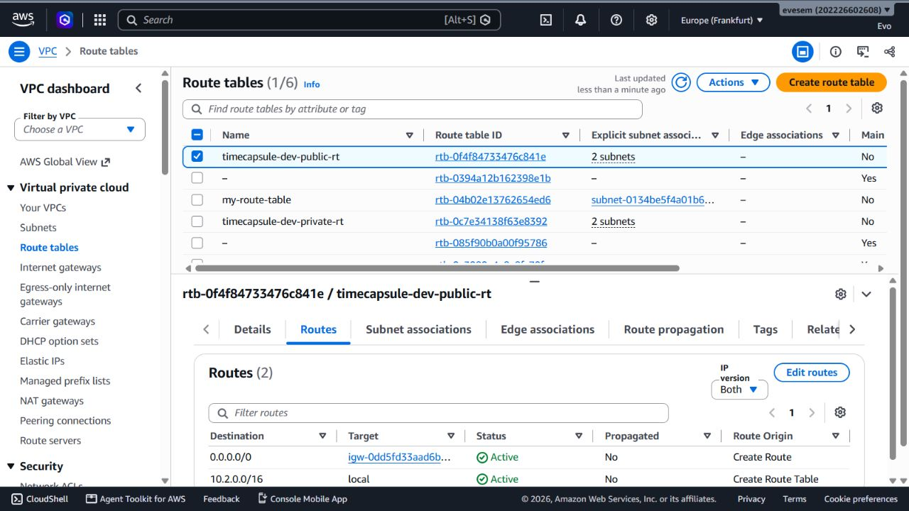
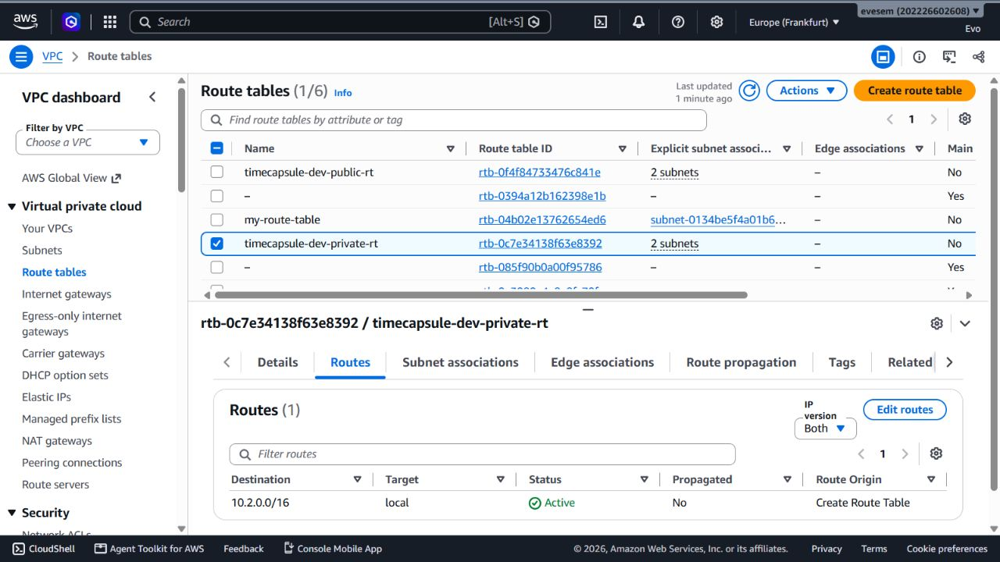
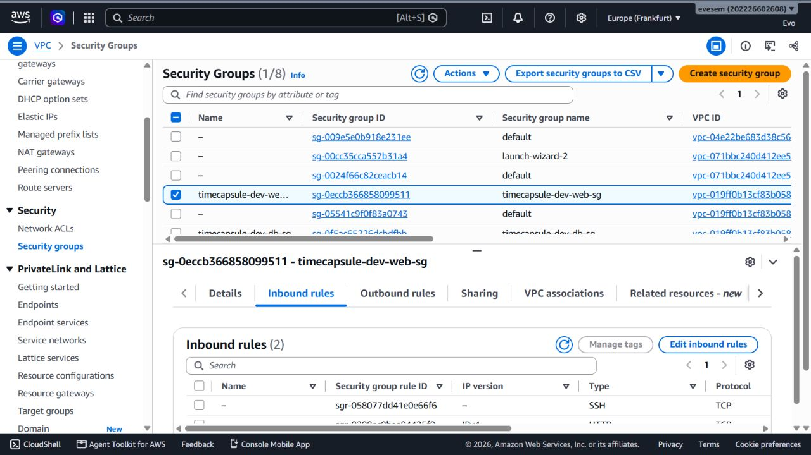
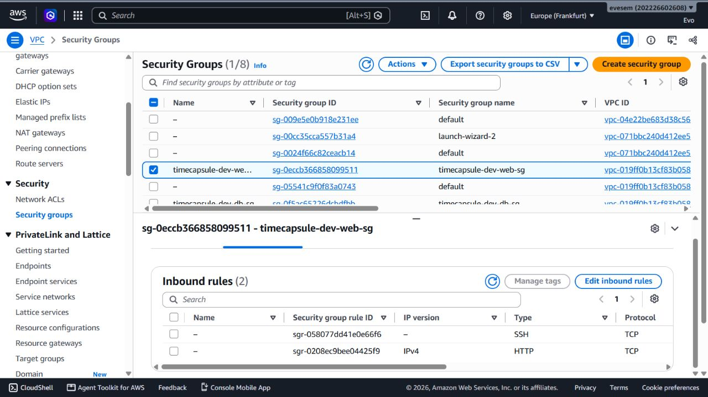
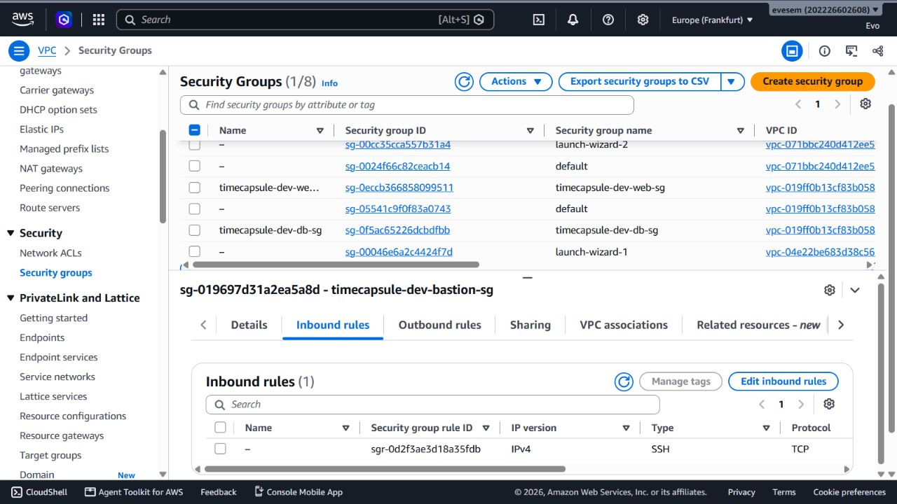
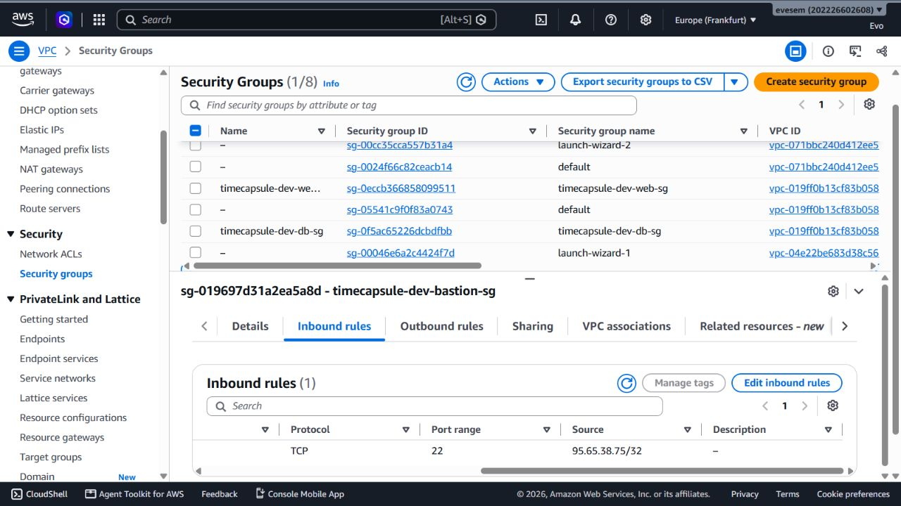
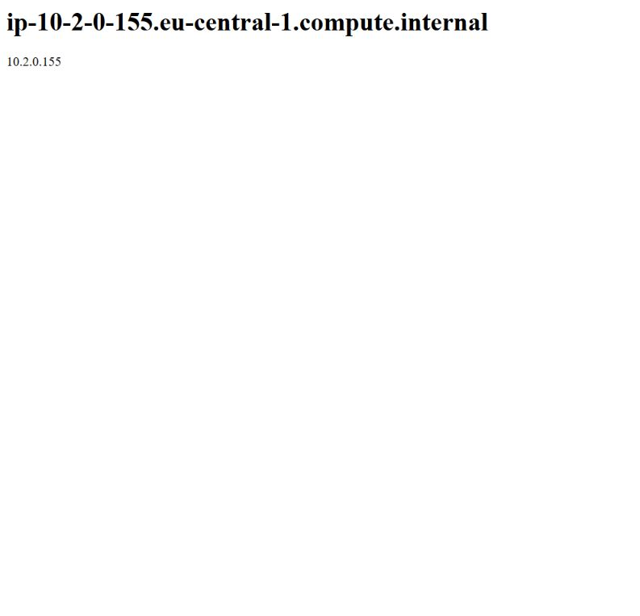

# Лабораторная работа №3. Облачные сети (Amazon VPC)

## Данные студента

- ФИО: **заполнить**
- Группа: **заполнить**
- Специальность: **заполнить**
- Номер `k`: **2**
- Уровень: базовый
- Регион AWS: `eu-central-1` (Frankfurt)

## 1. План адресов

`X = k % 30 = 2`. VPC: `10.2.0.0/16`.

| Подсеть | Зона доступности | Диапазон | Доступные экземплярам адреса | Количество |
|---|---|---|---|---:|
| `public-a` | `eu-central-1a` | `10.2.0.0/24` | `10.2.0.4`–`10.2.0.254` | 251 |
| `public-b` | `eu-central-1b` | `10.2.1.0/24` | `10.2.1.4`–`10.2.1.254` | 251 |
| `private-a` | `eu-central-1a` | `10.2.10.0/24` | `10.2.10.4`–`10.2.10.254` | 251 |
| `private-b` | `eu-central-1b` | `10.2.11.0/24` | `10.2.11.4`–`10.2.11.254` | 251 |

В каждой подсети `/24` всего 256 адресов, но AWS резервирует пять: первый адрес — адрес сети, второй — маршрутизатор VPC, третий — DNS-сервер, четвёртый — для будущего использования AWS, последний — широковещательный. Поэтому экземплярам доступны 251 адрес. В VPC `/16` помещается 256 подсетей `/24`.

## 2. Проверки и ответы

### Подсеть `public-a` после создания

Сразу после создания `public-a` ещё не обеспечивает выход в интернет: название подсети ничего не меняет. Для публичного доступа нужны маршрут `0.0.0.0/0` через Internet Gateway и публичный IPv4 адрес у экземпляра.

### Маршруты

В обеих таблицах есть локальный маршрут `10.2.0.0/16`, созданный AWS автоматически. Он обеспечивает обмен трафиком между подсетями VPC. Пакет из `private-a` к `8.8.8.8` не имеет подходящего маршрута по умолчанию, поэтому наружу не уйдёт.

### Security Groups

В `db-sg` источником для PostgreSQL указана `web-sg`, чтобы разрешить порт 5432 только экземплярам с этой группой. IP веб-сервера может измениться, а диапазон всей VPC открыл бы базу лишним серверам. Правило по Security Group сохраняет ограничение по роли сервера.

### Установка пакетов на `db-server`

`web-server` может обращаться в интернет через маршрут публичной подсети и Internet Gateway. У `db-server` в приватной подсети нет маршрута наружу; для исходящих обновлений временно добавляют NAT Gateway в публичную подсеть и маршрут к нему из приватной таблицы. NAT позволяет начинать соединения изнутри, но не открывает сервер для входящих соединений из интернета.

### Изоляция базы

После удаления NAT Gateway PostgreSQL продолжает работать: NAT нужен для исходящих соединений, а не для внутренних соединений между серверами VPC. Для установки обновлений NAT Gateway создают временно, добавляют маршрут в `private-rt`, обновляют пакеты, затем удаляют NAT, маршрут и освобождают его Elastic IP.

### Проверки соединения

- PostgreSQL доступен с `web-server`, потому что входящее правило `db-sg` разрешает TCP 5432 от `web-sg`.
- С `bastion` этот порт закрыт, хотя локальная маршрутизация VPC существует: Security Group базы не разрешает источником `bastion-sg`.
- `db-server` не может обратиться к GitHub после удаления NAT, поскольку в `private-rt` нет маршрута в интернет. Из интернета база недоступна: у неё нет публичного IP и маршрута через Internet Gateway, а Security Group также не разрешает внешний трафик на 5432.

### Эксперимент с Network ACL

Network ACL действует на уровне подсети и блокирует трафик до проверки Security Group. Правило `Deny` для домашнего IP блокирует и SSH, и сайт, даже если Security Groups их разрешают. Правило с номером 90 проверяется раньше правил с большими номерами; приоритет определяется меньшим номером. С телефона через мобильную сеть сайт доступен, потому что у телефона другой внешний IP.

### Имена и теги

В Tag Editor ресурсы проекта находятся фильтром `Project = timecapsule` в регионе `eu-central-1`. Тег `Owner` указывает ответственного и помогает связаться с ним или найти владельца ресурсов даже в общем учебном аккаунте.

## 3. Доказательства выполнения

Сохранённые скриншоты AWS лежат в каталоге [`screenshots`](screenshots/). На снимке bastion виден внешний IP компьютера; перед публикацией отчёта его стоит скрыть.

1. **Задание 1:** заполненная таблица адресов выше.
2. **Задание 3:** маршруты `public-rt` и `private-rt`, ассоциации с подсетями.
3. **Задание 4:** входящие правила `bastion-sg`, `web-sg`, `db-sg`.
4. **Задание 5:** страница nginx `web-server` и остановленная команда установки пакета на `db-server`.
5. **Задание 6:** `curl https://checkip.amazonaws.com` на `db-server`, маршрут `Blackhole`, NAT Gateway в состоянии `Deleted`.
6. **Задание 7:** подключение `psql` с `web-server`, проверки порта с `web-server` и `bastion`, эксперимент с Network ACL, список ресурсов Tag Editor.
7. **Завершение:** все три экземпляра остановлены; активных NAT Gateway нет; NAT Elastic IP освобождён.

### Скриншоты

#### Задание 3. Таблицы маршрутов

Публичная таблица маршрутов: `0.0.0.0/0` направлен через Internet Gateway, локальный маршрут `10.2.0.0/16` активен.

Приватная таблица содержит только локальный маршрут `10.2.0.0/16`.

#### Задание 4. Security Groups

Входящие правила `web-sg`: SSH и HTTP.

Детали правил `web-sg`.

Входящее правило bastion разрешает SSH на порт 22; на следующем снимке виден источник `95.65.38.75/32`.

#### Задание 5. Веб-сервер

Страница, отданная `web-server`; показаны hostname и приватный IP `10.2.0.155`.

### Зафиксированные результаты проверки

| Ресурс | Идентификатор / значение | Результат |
|---|---|---|
| VPC `timecapsule-dev-vpc` | `vpc-019ff0b13cf83b058` | `10.2.0.0/16` |
| `public-a` | `subnet-058e1254fc81a0f77` | `10.2.0.0/24`, `eu-central-1a` |
| `public-b` | `subnet-01fa1952587923305` | `10.2.1.0/24`, `eu-central-1b` |
| `private-a` | `subnet-06c75ffc8a9558e72` | `10.2.10.0/24`, `eu-central-1a` |
| `private-b` | `subnet-0ce0ced16b65c258e` | `10.2.11.0/24`, `eu-central-1b` |
| `public-rt` | `rtb-0f4f84733476c841e` | ассоциирована с `public-a` и `public-b`, маршрут через IGW активен |
| `private-rt` | `rtb-0c7e34138f63e8392` | ассоциирована с `private-a` и `private-b`, после удаления NAT остался только локальный маршрут |
| `bastion` | `i-0e4d08e6c64f0fe61` | остановлен; приватный IP `10.2.1.121` |
| `web-server` | `i-0ce1afe8d9d6dfc08` | остановлен; приватный IP `10.2.0.155` |
| `db-server` | `i-0ddf0d20d41658fe0` | остановлен; приватный IP `10.2.10.211`, публичного IP нет |

У всех ресурсов проекта обнаружены обязательные теги; владелец в существующей конфигурации указан как `Evo`. Проверено: веб-страница вернула HTTP 200; PostgreSQL слушал порт 5432, порт открыт с `web-server` и закрыт с `bastion`; с `db-server` подключение к GitHub без NAT завершилось тайм-аутом. Во время временного NAT команда `curl https://checkip.amazonaws.com` вернула адрес NAT Gateway, `dnf update` завершился успешно, PostgreSQL уже был установлен и активен. NAT Gateway удалён, маршрут `0.0.0.0/0` удалён из `private-rt`, Elastic IP шлюза освобождён.

Временное правило Network ACL №90 с действием `Deny` блокировало сайт и SSH с внешнего адреса компьютера; после удаления правила сайт снова стал доступен. После завершения работы все три экземпляра остановлены, активных NAT Gateway и выделенных Elastic IP нет.

Теги `Name`, `Project`, `Environment`, `Owner` и `Lab` проверены у VPC, подсетей, таблиц маршрутов, Internet Gateway, Security Groups, экземпляров и их дисков.

**Перед сдачей ещё нужно:** заполнить ФИО, группу и специальность; добавить снимок входящих правил `db-sg`; выполнить `psql -h 10.2.10.211 -U student -d lab3 -c "SELECT version();"` с паролем пользователя `student` (пароль не записывать в отчёт); открыть сайт с телефона через мобильную сеть и зафиксировать результат. Эти действия требуют твоих личных данных/секрета или устройства и не выполнены здесь. Также для полной подборки доказательств пригодятся снимки проверки установки пакета без NAT, `Blackhole` маршрута, NAT в состоянии `Deleted`, Tag Editor и итоговых остановленных экземпляров с освобождённым Elastic IP.

Текстовые результаты выше получены проверкой реальных ресурсов через AWS API и SSH, но они не заменяют требуемые снимки для сдачи.

## Итог

**Заполнить после выполнения:** краткий результат и приложить итоговые снимки списка экземпляров, NAT Gateway и Elastic IP.

