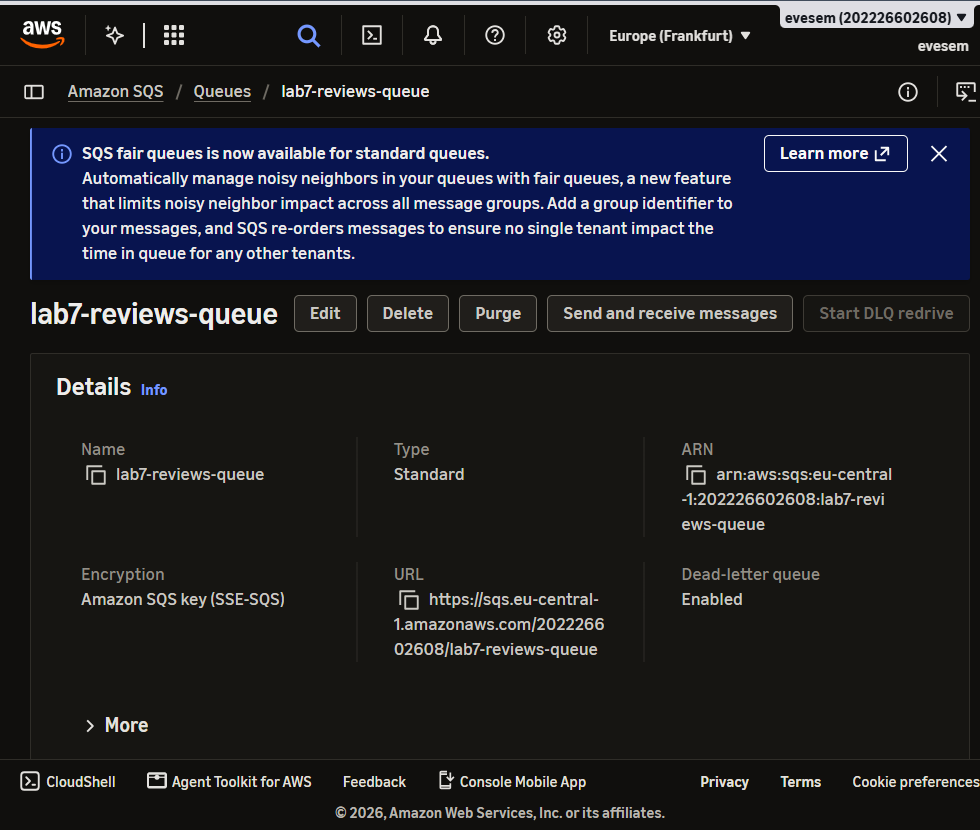
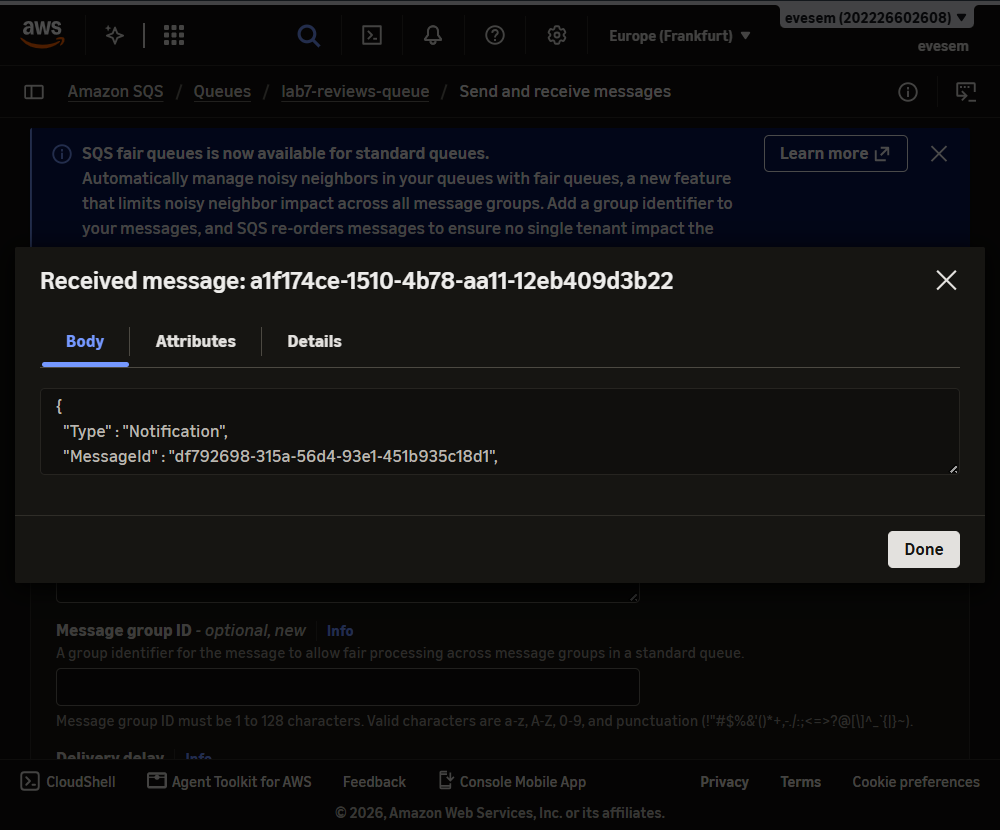
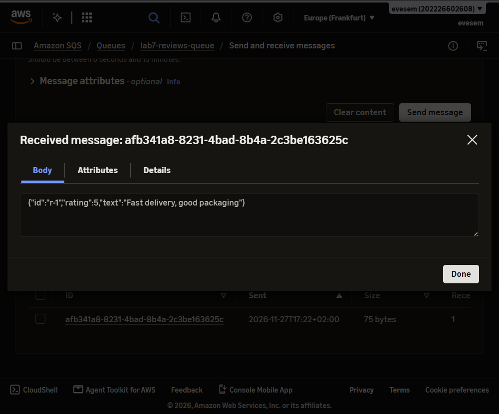
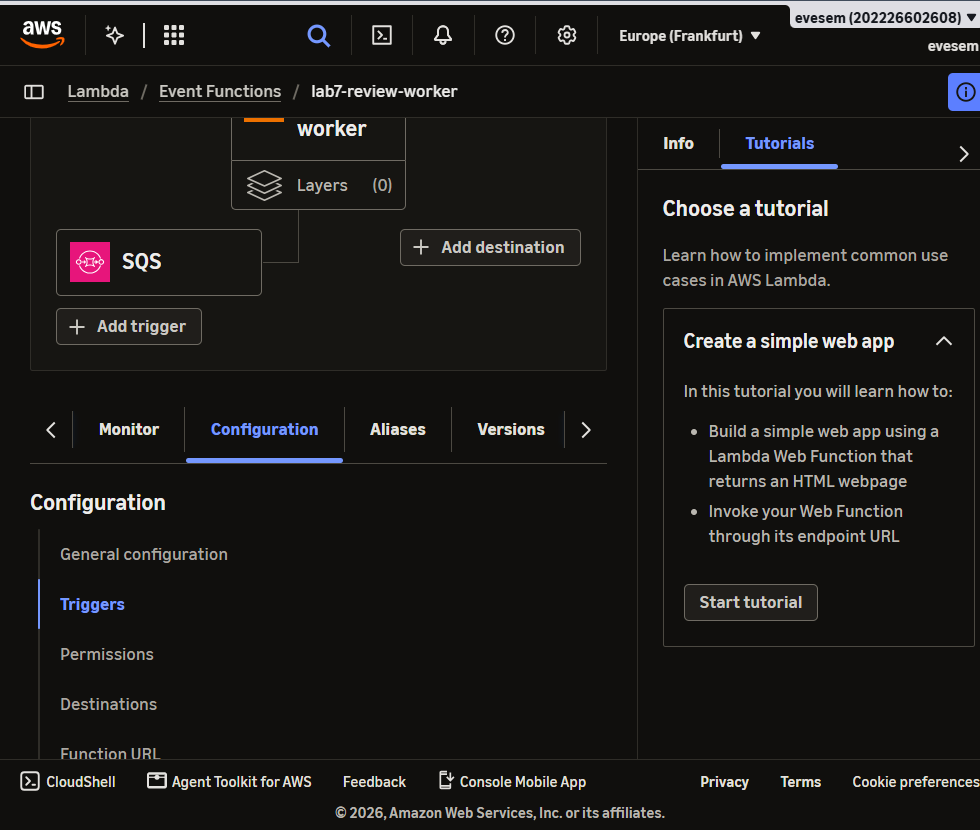
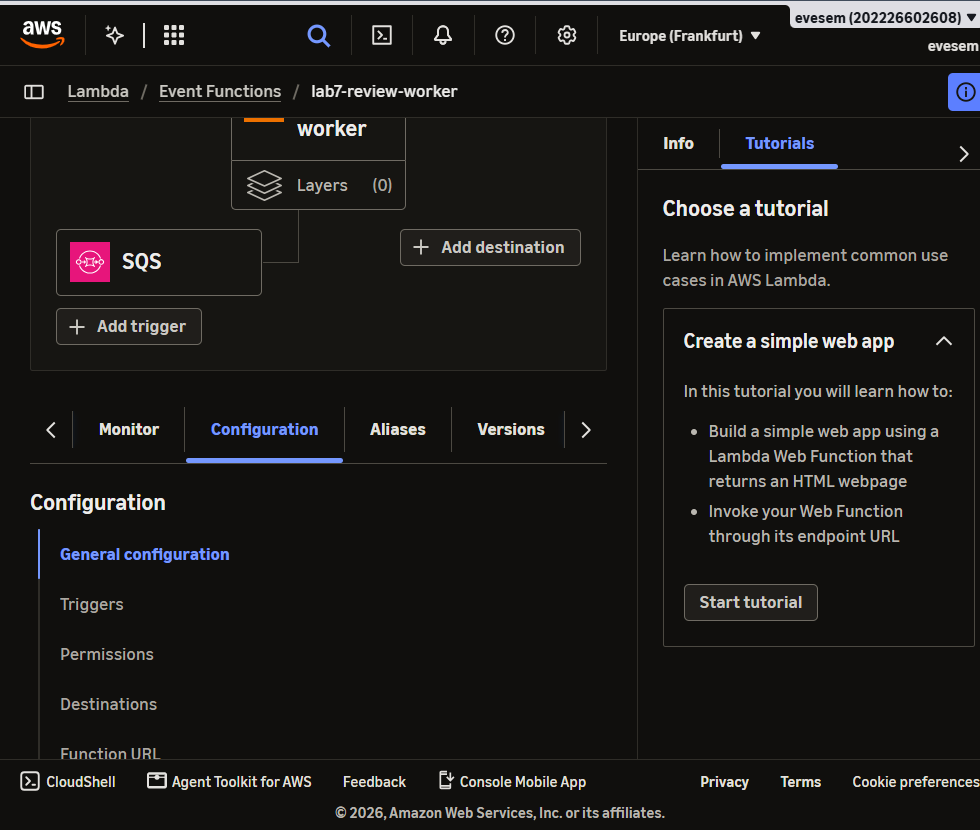
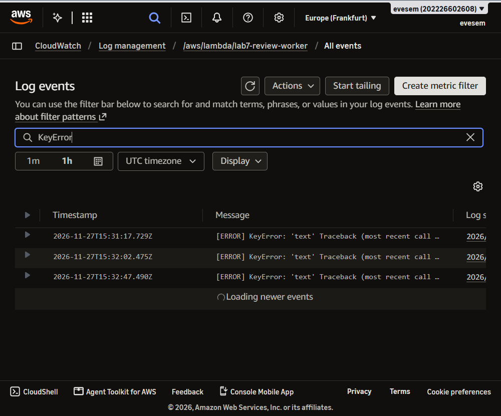
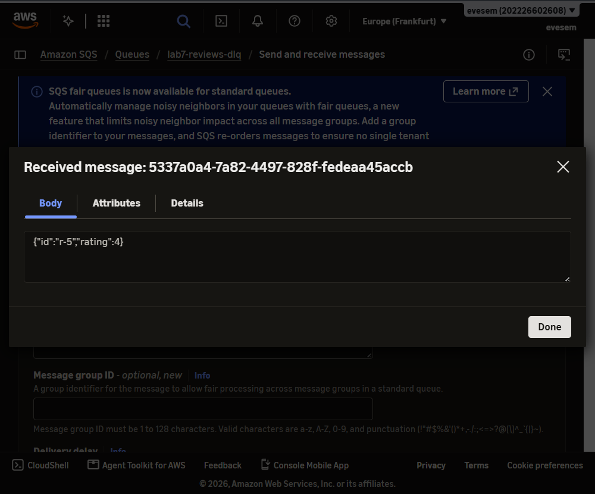
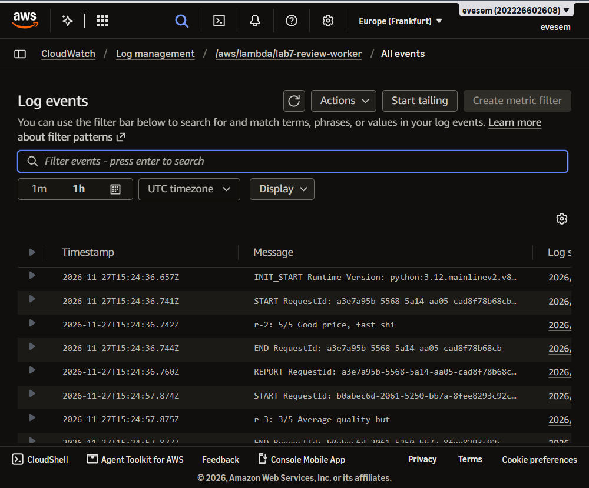

# ЛР7. Базовый уровень

Отзывы идут через тему SNS → очередь SQS → Lambda. Плохие отзывы (оценка 1 или 2) дополнительно приходят на почту. Регион `eu-central-1`, все ресурсы с префиксом `lab7-` и тегом `Lab=lab7`.

Код обработчика: [`lambda_function_broken.py`](lambda/lambda_function_broken.py) (первая версия) и [`lambda_function.py`](lambda/lambda_function.py) (исправленная).

## 1. Тема и очередь

Созданы тема `lab7-reviews`, очередь `lab7-reviews-queue` и DLQ `lab7-reviews-dlq`. Очередь подписана на тему с `Raw message delivery = true` — Lambda получает сразу JSON отзыва.

Параметры очереди:

- visibility timeout — 30 с: дольше таймаута Lambda (10 с), чтобы сообщение не стало видно снова во время обработки;
- хранение сообщений — 4 дня: хватает, чтобы исправить обработчик и вернуть отзыв из DLQ;
- `maxReceiveCount` — 3: после трёх неудач отзыв уходит в DLQ;
- пачка — 10 сообщений, окно батчинга — 5 с: отзывы, опубликованные почти одновременно, обрабатываются одним вызовом.



Для сравнения сначала включили `Raw message delivery = false`. В очереди лежала обёртка SNS с полем `Message`:



После включения настройки тело сообщения — только JSON отзыва:



Сообщение снова появляется в очереди через 30 с, потому что получение только скрывает его. Если его не удалить, SQS считает обработку незавершённой и возвращает отзыв.

## 2. Обработчик отзывов

Lambda `lab7-review-worker` (Python 3.12) пишет в журнал строку `r-2: 5/5 Good price, fast shi`: идентификатор, оценку и первые 20 символов текста.





Три отзыва подряд дали три вызова функции. Батч-окно 5 с объединяет только сообщения, пришедшие почти одновременно, а публикации были разнесены во времени.

## 3. Отзыв без текста

Опубликовали отзыв `{"id":"r-5","rating":4}` без поля `text`. Первая версия обработчика падала с `KeyError: 'text'`. Отзыв был получен три раза и ушёл в DLQ:





В DLQ он попал не сразу: SQS скрывает сообщение на 30 с и пробует снова; в DLQ — после третьей неудачи. Исправили строку на `review.get("text", "")[:20]` и вернули отзыв через `Start DLQ redrive`. В журнале появилось `r-5: 4/5`.

Если в пачке из десяти отзывов один вызовет ошибку, без `ReportBatchItemFailures` вся пачка пойдёт в повтор — остальные отзывы тоже обработаются ещё раз.

## 4. Плохие отзывы на почту

Подписка на почту подтверждена. К ней применён фильтр по атрибуту `rating`:

```json
{"rating": [{"numeric": ["<", 3]}]}
```

Очередь по-прежнему получает все отзывы; фильтр стоит только на почтовой подписке.

| Отзыв | Почта | Журнал Lambda |
| --- | --- | --- |
| `rating = 1` (`r-6`) | Да | Да |
| `rating = 3` (`r-7`) | Нет | Да |
| `rating = 5` (`r-8`) | Нет | Да |
| без `rating` (`r-9`) | Нет | Да |



Отзыв без атрибута не пришёл: фильтр проверяет атрибуты сообщения SNS, а не поля JSON в теле. Если бы издатель отправлял отзывы сразу в каждую очередь, для нового получателя пришлось бы менять его код; с темой SNS достаточно добавить подписку.

## Удаление

Удалены триггер, Lambda-функция, группа журналов, обе очереди, тема SNS и IAM-роль. Проверено: ресурсов с префиксом `lab7-` не осталось.
